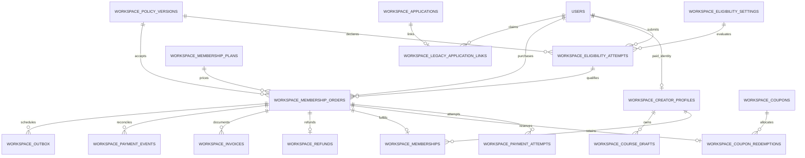
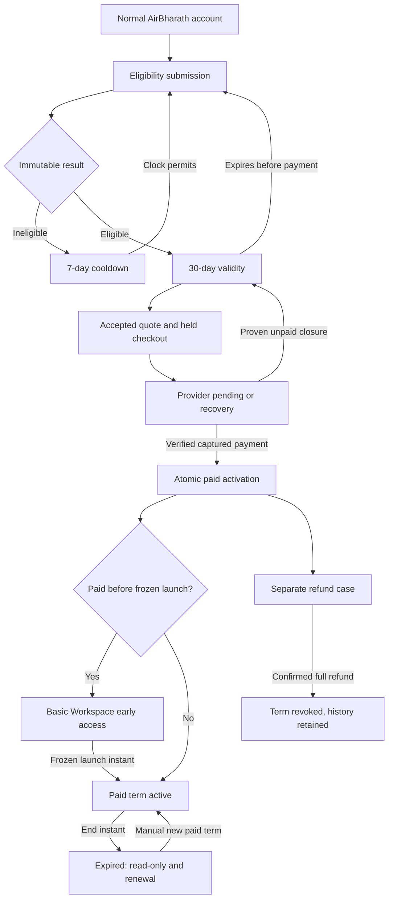

# AirBharath Workspace — Phase 1.2 Architecture

**Design only; proposed for review.** Reviewed 6 October 2026 against commit `04cedfd`, branch `feat/workspace-registration`. No Phase 1.3–1.7 implementation is authorized by this report.

This requested report is the sole file deliverable and exception to the brief's general instruction not to change the repository. No application code, UI, routes, schema, migrations, dependencies, provider configuration or database records are changed. Terminology/decisions are recorded here rather than in additional glossary or ADR files. Proposed names describe future work, not existing functionality.

## A. Executive Architecture Recommendation

Build Workspace as a separate domain inside the existing Next.js/Drizzle/PostgreSQL application, sharing normal AirBharath accounts and OTP sessions. Preserve `student`/`admin` as primary roles. A creator is a paid Workspace identity with a current entitlement, not a third role or course enrollment.

Primary journey: `/workspace` → normal account login when needed → authenticated short eligibility check → eligible result → plan/price quote → coupon reservation/payment → transactional creator/membership activation → Basic Workspace profile/private drafts. Preserve manual Phase 1 applications as a distinct secondary acquisition/support workflow with original records and communication history.

Recommend immutable eligibility submissions and rule versions, one creator profile per user created only after successful paid activation, one membership row per purchased term, isolated Workspace financial orders and a new Workspace-safe coupon ledger. Do not retrofit course coupons or reuse course invoice tax assumptions in this MVP. Keep conceptual scopes `workspace_membership` and `course_purchase`; the latter's future creator coupon implementation remains outside this design.

Use separate entity state machines. Dates derive eligibility expiry, cooldown, early access and membership expiry; refund cases and administrative suspension remain independent. One server journey resolver determines navigation; a separate capability resolver authorizes every protected read/write.

Browser confirmation, signed webhook and reconciliation converge on one fulfillment service. Verified captured payment must match persisted provider order, amount, currency and owner context. Finalize order fulfillment, coupon redemption, creator creation, membership issuance and durable side-effect jobs in one PostgreSQL transaction. Provider HTTP calls stay outside transactions.

For the first release, recommend conservative coupon holds: once provider order creation starts, retain capacity until redeemed or proven safe to release. Local checkout expiry does not make a provider order unpayable. This protects the cap but can strand abandoned capacity. Short reusable reservations need proven provider closure or isolated manual capture; Section I presents that alternative and its approval gate.

### Confirmed baseline

|  Topic  |  Confirmed requirement  |
|  ---  |  ---  |
|  Audience/result  |  Individual aviation professionals; instant **eligibility** from structured self-declarations, not credential verification/scraping  |
|  Eligibility  |  Minimum 2 years; professional HTTPS profile required; eligible for 30 days; reapply after ineligible after 7 days  |
|  Identity  |  Existing AirBharath account; creator capability separate from `users.role`; eligibility alone grants no creator access  |
|  Plans  |  Quarterly ₹4,999; Half-Yearly ₹8,999; Yearly ₹16,999; each base + 18% GST, prepaid fixed term, manual renewal, no recurring billing  |
|  Launch  |  Full launch 9 November 2026; earlier buyers get immediate Basic Workspace; paid term starts on launch; later buyers start on payment date  |
|  Refund  |  3 calendar days from successful payment; false-information consequences require authorized human decisions under final policy  |
|  Coupons  |  Admin-created; one successful use of a particular coupon per user; later different coupon possible on an eligible purchase; plan targeting and campaign metadata  |
|  Basic Workspace  |  Profile, membership display and multiple private course drafts; membership does not approve a course; creators initially bring their audience  |
|  Manual applications  |  Preserve; no automatic conversion into creator identity, membership or eligibility  |

Canonical terms: **user** is the login identity; **eligibility attempt** is an immutable declaration/result; **creator profile** is the durable paid-activated identity; **membership term** is one funded paid interval; **early access** is a separate immediately usable pre-term entitlement; **accepted order** is the immutable purchase agreement/provider coordination record; **reservation** holds coupon capacity; **redemption** is successful paid use retained after refund; **draft** is private preparation content; **professional verification** is a possible later evidence-based process.

## B. Existing LMS Constraints

|  Area  |  Repository evidence and observed behavior  |  Architectural consequence  |
|  ---  |  ---  |  ---  |
|  User identity  |  [schema.ts](</home/rishisingh1034/Desktop/eresha-repo/airbharath-lms/lib/db/schema.ts:6>): UUID, unique phone, email not unique, student default  |  Owner is authenticated `users.id`, never matched email; OTP possession does not verify professional URL/email  |
|  OTP  |  [auth.ts](</home/rishisingh1034/Desktop/eresha-repo/airbharath-lms/lib/auth.ts>), [auth-policy.ts](</home/rishisingh1034/Desktop/eresha-repo/airbharath-lms/lib/auth-policy.ts>): MSG91 verification before lookup/create, new users student; [limiter](</home/rishisingh1034/Desktop/eresha-repo/airbharath-lms/lib/otp-rate-limit.ts>) uses Upstash REST and fails closed  |  Reuse normal login; eligibility has separate abuse budgets and persisted-user lookup  |
|  Session  |  [auth.ts](</home/rishisingh1034/Desktop/eresha-repo/airbharath-lms/lib/auth.ts:33>): 30-day HS256 JWT, HTTP-only `ab_session`, Secure in production, SameSite=Lax, identity/role claims  |  Token identifies candidate user; reload persisted account/entitlement; no creator or membership claim in JWT  |
|  Admin  |  [admin-authorization.ts](</home/rishisingh1034/Desktop/eresha-repo/airbharath-lms/lib/admin-authorization.ts>), [layout](</home/rishisingh1034/Desktop/eresha-repo/airbharath-lms/app/(admin)/layout.tsx>) recheck persisted role  |  Reuse for every new admin API/page; sensitive commands audited  |
|  Routing  |  [middleware.ts](</home/rishisingh1034/Desktop/eresha-repo/airbharath-lms/middleware.ts>): exact `/workspace` public, APIs excluded, admin middleware uses JWT role; [login](</home/rishisingh1034/Desktop/eresha-repo/airbharath-lms/app/(auth)/login/page.tsx:31>) sanitizes internal callback  |  New pages/APIs need server guards; preserve callback to `/workspace/apply`; middleware is not entitlement authority  |
|  Manual Workspace  |  [schema](</home/rishisingh1034/Desktop/eresha-repo/airbharath-lms/lib/db/schema.ts:19>), [submission](</home/rishisingh1034/Desktop/eresha-repo/airbharath-lms/app/api/workspace/applications/route.ts>), [review](</home/rishisingh1034/Desktop/eresha-repo/airbharath-lms/app/api/admin/workspace-applications/[id]/route.ts>): no applicant-user FK, long answers, consent versions, idempotent receipt, controlled review  |  Not the new short eligibility model; preserve original rows and semantics  |
|  Approval email  |  [approval-email.ts](</home/rishisingh1034/Desktop/eresha-repo/airbharath-lms/lib/workspace/approval-email.ts>): exact preview binding, approved-only atomic Sending claim, explicit retry/resend  |  Communication stays independent; approval/send never activates access; ambiguous provider sends need operators  |
|  Courses  |  [schema](</home/rishisingh1034/Desktop/eresha-repo/airbharath-lms/lib/db/schema.ts:77>), [admin CRUD](</home/rishisingh1034/Desktop/eresha-repo/airbharath-lms/app/api/admin/courses/route.ts>): instructor FK set to creating admin; authors are descriptive rows  |  Do not expose admin CRUD or interpret authors as creator ownership; isolated drafts  |
|  Enrollment/access  |  [course-access.ts](</home/rishisingh1034/Desktop/eresha-repo/airbharath-lms/lib/course-access.ts>): persisted enrollment/date and bundle resolver with persisted admin check  |  Learner access stays independent from Workspace expiry/refund  |
|  Payment  |  [order](</home/rishisingh1034/Desktop/eresha-repo/airbharath-lms/app/api/payments/razorpay/order/route.ts>), [verify](</home/rishisingh1034/Desktop/eresha-repo/airbharath-lms/app/api/payments/razorpay/verify/route.ts>): provider before local insert; useful HMAC/owner/paid CAS; enrollment later; no capture/amount fetch or payment webhook  |  Separate Workspace orchestration/fulfillment; callback signature alone cannot issue membership  |
|  Checkout failures  |  [EnrollButton](</home/rishisingh1034/Desktop/eresha-repo/airbharath-lms/components/EnrollButton.tsx:99>): dismissal/network handling, no durable recovery journey; verifier replay can skip failed enrollment repair  |  Persist recovery and fulfillment separately from payment facts; worker/webhook required  |
|  Invoice  |  [generator](</home/rishisingh1034/Desktop/eresha-repo/airbharath-lms/lib/invoice-generator.ts:19>), [schema](</home/rishisingh1034/Desktop/eresha-repo/airbharath-lms/lib/db/schema.ts:216>): fixed GST-inclusive back-calculation, course-order FK, no unique invoice-per-order  |  Reuse rendering primitives only; exclusive-tax snapshots and Workspace association needed  |
|  Coupon  |  [audit](</home/rishisingh1034/Desktop/eresha-repo/airbharath-lms/WORKSPACE_COUPON_AUDIT.md>), [schema](</home/rishisingh1034/Desktop/eresha-repo/airbharath-lms/lib/db/schema.ts:264>), validate/admin/order handlers: usedCount readers/default but no increment, ledger/scope/per-user rule absent  |  New Workspace ledger; no reliance on legacy count or silent full-price fallback  |
|  Analytics  |  [privacy filter](</home/rishisingh1034/Desktop/eresha-repo/airbharath-lms/lib/workspace/analytics-privacy.ts>), [provider](</home/rishisingh1034/Desktop/eresha-repo/airbharath-lms/components/providers/PostHogProvider.tsx>), [report](</home/rishisingh1034/Desktop/eresha-repo/airbharath-lms/WORKSPACE_ANALYTICS.md>)  |  Current filter covers `/workspace` and legacy admin paths, not proposed nested paths; normal login can still identify  |
|  DB target/migrations  |  [runner](</home/rishisingh1034/Desktop/eresha-repo/airbharath-lms/scripts/migrate.mjs>), [guards](</home/rishisingh1034/Desktop/eresha-repo/airbharath-lms/scripts/database-safety.mjs>), [runtime](</home/rishisingh1034/Desktop/eresha-repo/airbharath-lms/lib/db/index.ts>)  |  Versioned guarded migrations, not push. Runtime fallback/substring5433 shortcut can differ from migration target; authorized hardening required  |

Journal contains `0000`–`0008`. [0007](</home/rishisingh1034/Desktop/eresha-repo/airbharath-lms/drizzle/0007_lucky_wild_pack.sql>) adds manual applications; [0008](</home/rishisingh1034/Desktop/eresha-repo/airbharath-lms/drizzle/0008_eager_energizer.sql>) adds approval-email state. Earlier work recorded local `0007` applied and `0008` unapplied; Phase 1 report's earlier “not executed” statement is historical. This audit queries no DB and establishes no current environment ledger.

Current [privacy](</home/rishisingh1034/Desktop/eresha-repo/airbharath-lms/app/(user)/privacy/page.tsx>) is generic learner/billing disclosure; [terms](</home/rishisingh1034/Desktop/eresha-repo/airbharath-lms/app/(user)/terms/page.tsx:77>) has course-specific refund conditions. Neither becomes a creator agreement automatically. Prior audit's ₹5,000 quarterly context is superseded by this brief's ₹4,999. No durable financial inbox/outbox, payment reconciliation scheduler or refund workflow was found in inspected code.

## C. Proposed Domain Model

Use one application/database, shared existing infrastructure and isolated domain services; no new identity provider, microservice, generic workflow engine or subscription engine. All new entity PKs are UUIDs; timestamps are timezone-aware UTC instants, calendar rules carry an explicit IANA timezone. `createdAt` is never synonymous with paidAt. Financial/history FKs normally restrict deletion; approved privacy redaction/pseudonymization is separate from destructive cascades.

|  Proposed table  |  Purpose, fields/status and timestamps  |  FK, uniqueness, checks/indexes  |  Mutable/history and deletion  |
|  ---  |  ---  |  ---  |  ---  |
|  `workspace_eligibility_settings`  |  Published versions: minExperienceMonths = 24, allowedCategoryCodes, profileRequired = true, validityDays = 30, cooldownDays = 7, launchDate/timezone, evaluatorVersion/hash, isCurrent, publishedAt/by  |  PK id; unique version; partial unique current; publisher→users; bounded values/known categories; publishedAt index  |  Published content immutable; current flag only changes atomically. Publisher delete set-null; referenced version restrict delete  |
|  `workspace_eligibility_attempts`  |  Immutable category, experienceMonths, professional status/URL, teaching category/short idea, declarations/policy/acceptedAt, result eligible/ineligible/reasons, submittedAt/decidedAt, eligibleUntil or reapplyAt; automatic/admin_override source, decisionActorId, and supersedesAttemptId  |  PK id; user/settings/policy/superseded-attempt FKs restrict; override actor→users set-null; unique(userId,submissionKey)+hash; indexes(userId,decidedAt), (result,decidedAt); outcome/date consistency and same-user supersession  |  Immutable submission/result; override is new linked decision, never overwrites answer. Approved retention/redaction outside normal CRUD  |
|  `workspace_creator_profiles`  |  Paid identity: userId, displayName/title/category/experience/profileUrl/bio; enabled/suspended/terminated operational status, actor/reason/statusChangedAt, createdAt/updatedAt/version  |  PK id; unique userId; user FK restrict, actor set-null; unique(id,userId) for owner-consistent children; status/time index  |  Profile fields/current operational status mutable with optimistic version/audit; expiry/refund retain identity; hard delete restricted  |
|  `workspace_membership_plans`  |  Immutable code/version/name, durationMonths = 3/6/12, basePricePaise, taxRateBps = 1800, INR, isCurrent/available, publishedAt/by  |  PK id; unique(code,version); partial unique current per code; bounded positive prices/durations; publisher set-null; code/current index  |  Publish new row for economics; availability/current flags mutable/audited; referenced versions restrict deletion  |
|  `workspace_coupons`  |  Scoped code=workspace_membership, targeted plan codes or any-plan, fixed/percentage, discountPaise or discountBps, startsAt/endsAt, nullable usageLimit, active/paused/archived, campaign/sourceType/sourceName, createdAt/by/updatedAt/version  |  PK id; unique normalized code in scope; checks exclusive discount representation, positive limit or null, date order, valid plan codes; state/end and campaign indexes; admin FK set-null  |  Freeze code/economics/attribution after first provider-backed hold; new offer=new code. State/limit audited under lock; limit never below occupied capacity. Archive, don't delete  |
|  `workspace_coupon_redemptions`  |  Per-order capacity/use ledger: couponId,userId,orderId; reserved/redeemed/released; reservedAt, localCheckoutExpiresAt, redeemedAt, capacityReleasedAt/evidence/reason; offer/attribution snapshots  |  PK id; coupon/user/order FKs restrict; unique orderId; partial unique(couponId,userId) for reserved/redeemed; coupon/status and status/deadline indexes; owner-consistent order FK  |  Mutable transition metadata; redeemed permanent including refunds, released rows retained; no cascade/counter-only truth  |
|  `workspace_membership_orders`  |  Accepted immutable financial/date/policy quote; userId, eligibilityAttemptId, planVersionId, activation/renewal, predecessorMembershipId, requestKey/hash; providerReceipt/orderId; checkout creating/ready/closed/recovery_required; fulfillment pending/fulfilled/held; paidAt/source, activatedAt, refundEligibleUntil, createdAt/updatedAt  |  PK id; user/attempt/plan/policy/predecessor FKs restrict; unique(userId,requestKey), providerReceipt, providerOrderId; partial unique user for explicitly unresolved checkout states; user/time, checkout/time, fulfillment/paid indexes  |  Accepted economics/agreement/date rules immutable; reconciliation fields mutable only via services. Retain payment/history on refund  |
|  `workspace_payment_attempts`  |  Multiple failed/authorized/captured attempts per provider order: provider account/mode/paymentId, amountPaise/currency; observed/authorized/captured/failed/refunded facts; providerCreatedAt, captureEvidenceAt/source, observedAt, cumulativeRefundedPaise  |  PK id; order FK restrict; unique(account,mode,providerPaymentId); order/time index; order has unique winning payment reference  |  Monotonic evidence/state; failure may later reconcile; captured amount never overwritten by refund; retained  |
|  `workspace_memberships`  |  One paid term: profileId,userId,orderId,winningPaymentId, plan/duration, purchasedAt, activatedAt, earlyAccessStartedAt nullable, membershipStartAt/endAt, issued/revoked, revokedAt/reason, renewalOfId  |  PK id; unique orderId and winningPaymentId; composite profile/user and order/user FKs, predecessor FK restrict; user/end index; start<end; issued interval non-overlap (H)  |  Dates/paid terms immutable; revocation separately audited. No persisted active/expired churn; retain history  |
|  `workspace_payment_events`  |  Durable verified webhook inbox: account/mode,eventId/type, payloadHash, minimized order/payment evidence, receivedAt/processedAt; pending/processed/retry/needs_review, attempts/nextAttemptAt  |  PK id; unique(account,mode,eventId); optional order FK restrict; status/nextAttempt index  |  Evidence immutable, retry metadata mutable; matched/unmatched recovery; minimal payload/retention rather than full PII body  |
|  `workspace_outbox`  |  Durable post-commit invoice/email/analytics jobs: orderId and optional membershipId/event references, version, minimal identifiers, pending/processing/done/failed, attempts,nextAttemptAt,claimedUntil/completedAt  |  PK id; unique(kind,aggregateId,eventVersion); order/membership/event FKs restrict; status/nextAttempt index  |  Lease/retry metadata mutable; bounded completed retention; jobs never grant access; no exactly-once email promise  |
|  `workspace_policy_versions`  |  Immutable eligibility or checkout bundle with actual approved text/document versions/retained artifact/hash; kind/version,isCurrent,publishedAt/by  |  PK id; unique(kind,version); partial unique current/kind; publisher set-null; referenced versions restrict  |  Never edit published copy; acceptance user/time/context stored on immutable attempt/order (M); no separate consent platform needed  |
|  `workspace_refunds`  |  Minimal V1 full-refund case/order: requestedAmountPaise, requestKind, requestedAt; requested/approved/rejected/provider_pending/refunded/failed, decisionAt/by/reason, providerRefundId/submittedAt/completedAt, requestKey, window/policy snapshots  |  PK id; unique orderId in V1, providerRefundId, requestKey; order/payment FKs restrict, reviewer set-null; status/update and requestedAt indexes; amount bounded by captured less refunded  |  History retained; reopen/retry audited. Partial/multiple cases require later model extension; no ticket subsystem  |
|  `workspace_audit_events`  |  Admin/sensitive transition evidence: actor,targetType/id,action,reason,bounded before/after,requestKey,createdAt  |  PK id; actor FK set-null; scoped unique command key; target/time and actor/time indexes; polymorphic target validity via service  |  Append-only; no admin edit/delete or raw secrets/provider dumps; no fictitious polymorphic FK  |
|  `workspace_legacy_application_links`  |  Optional proof-based link: applicationId,userId,linkedAt/by,proofMethod/provenance; no entitlement  |  PK id; unique applicationId; application/user FKs restrict; admin set-null; user index  |  Explicit audited linking/correction; old application unchanged; not needed until actual linking action offered  |
|  `workspace_course_drafts`  |  Profile-owned title/category/description/target learner/outcomes/tentativePricePaise, optional bounded outline JSON; draft/archived, createdAt/updatedAt/archivedAt/version  |  PK id; creator FK restrict; creator/state/update index; bounded fields/nonnegative price; future importedCourseId FK only in promotion phase  |  Mutable/versioned private content; archive rather than delete; retain read-only after expiry/refund; approved content retention separate  |
|  `workspace_invoices`  |  Snapshot invoice/credit note: orderId, fiscal number, kind, originalInvoiceId, issuedAt, seller/buyer/tax/line snapshots, artifact/hash/generation state  |  PK id; unique number and(orderId,kind) for V1 one invoice/full-refund credit note; order/original FK restrict; order/issued index  |  Issued economics/document immutable; idempotent generation; correction by credit note, no old-price recalculation  |

Every table above has its PK, key FKs, lifecycle/time, constraints/indexes and deletion behavior specified. Additional composite owner FKs must ensure attempt/order/profile/payment/term links refer to the same user; enforce via matching unique composite keys, not client assertions. Order references user because creator does not yet exist at checkout. Refund/admin actors can be set-null while action history remains.

This is an explicit reliability model staged across phases, not all-at-once scope:1.3 needs settings/attempt/policy/audit;1.4 plans/coupons;1.5 needs financial orders/ledger/identity/terms/inbox/outbox. Drafts wait until 1.6. Optional legacy links wait until supported. Inbox/outbox/payment-attempt evidence are minimal recovery infrastructure rather than optional enterprise features.

## D. Entity Relationship Diagram

Actor FKs, self-references and polymorphic audit omitted for readability. Verified unmatched events can temporarily have no order FK. One winning captured payment funds a membership; several failed payment attempts can precede it. Existing learner course/order/enrollment relationships stay independent.

## E. Workspace State Machine

|  Entity  |  Persisted lifecycle  |  Derived journey/presentation  |
|  ---  |  ---  |  ---  |
|  Eligibility  |  Immutable eligible/ineligible result, reasons, deadlines, policy/source  |  not_started; eligible/eligibility_expired by clock; ineligible_cooldown/reapply_available  |
|  Form editing  |  No server draft in MVP  |  eligibility_in_progress in page/tab state only; cannot override submitted result  |
|  Order  |  checkout creating→ready/recovery_required→closed; fulfillment pending/fulfilled/held separate  |  checkout_started/payment_pending/recovery_required from durable facts  |
|  Payment attempt  |  observed/authorized/captured/failed/refunded facts, monotonic reconciliation  |  Browser failure/dismissal does not close order  |
|  Coupon use  |  reserved→redeemed or proven-safe released  |  UI expiry is not released capacity  |
|  Creator profile  |  enabled↔suspended; enabled/suspended→terminated under admin command  |  Identity existence does not imply entitlement; expiry is not suspension  |
|  Membership  |  issued→revoked  |  future_term, paid_early_access, active, expiring, expired from dates/revocation; expiring is warning only  |
|  Refund  |  requested→approved/rejected; approved→provider_pending→refunded/failed; audited retry/reopen  |  refund_requested overlays access, does not mean refunded  |
|  Course draft  |  draft↔archived  |  editable/read-only from current capability; no publication state in MVP  |
|  Manual application  |  Existing eight application statuses plus independent four communication states  |  Display separately; approved/invited_to_activate never means membership  |

Transitions: eligibility submission requires persisted user, valid data/declarations, no active result/cooldown, serialization and idempotency. Settings publication requires persisted admin, optimistic version and audit; it adds a version instead of changing historical rules. Checkout requires current eligible/renewal basis, accepted server quote, no competing unresolved order. Captured confirmation requires exact provider evidence; valid purchase atomically issues identity/term/redemption. Launch/start/end clock transitions do not require cron writes. Full confirmed refund explicitly revokes its term; suspension is an independent audited creator restriction.

Suspension can block early/paid access independently. A pending renewal does not block the current paid term. Diagram arrows represent independent entity events/date transitions, not one giant persisted enum.

## F. Eligibility Architecture

A single typed policy evaluator owns bounded known settings; no arbitrary expressions/scripts/scoring or generic rules builder. Initial defaults:24 experience months, professional HTTPS profile required,30-day validity,7-day cooldown and 9 November 2026 full launch. Category list is configurable; professional status is descriptive unless a separately approved rule makes it disqualifying.

Short form uses stable category/status/teaching-category select codes, experience options supporting exactly24 months, professional URL, bounded minimal idea/title (approximately 200 characters) and confirmations: genuine expertise, accuracy, eligibility not course approval, future course review, initial own-audience responsibility, no false DGCA/airline/government approval claims. Bio/profile presentation waits until Basic Workspace.

Legacy experience labels like2–5 years cannot reliably evaluate every future numerical threshold. Store exact normalized months or conservative minimum months tied to stable options; retain selected option. Never compare labels or invent an unprovided midpoint. Approve the initial allowed professional/teaching categories from the existing aviation catalog; existing presence in Phase 1 is not proof of approval for automated onboarding.

Rules evaluate configured aviation category, sufficient experience, required valid URL and accepted declarations. Teaching category must be supported; proposed title is validated for presence/length, not AI quality or publication approval. A malformed URL/missing acknowledgment/bad enum is a field validation error, **not** an ineligible submission penalized for seven days. A complete submission failing a qualification rule creates ineligible result with controlled reasons such as insufficient_experience/category_not_onboarding.

Store rule-version FK/hash, evaluator version, policy bundle/acceptedAt, immutable submitted answers/reasons, decidedAt and eligibleUntil or reapplyAt. Recommend exact elapsed30/7 days for eligibility/cooldown, half-open validity now<eligibleUntil and reapplication now≥reapplyAt; render explicit local time labels. These intervals are separate from calendar-day refund semantics.

Serialize on the persisted user row before checking latest attempt. Matching idempotency key/hash returns original deadlines; changed same-key payload conflicts. New requests during existing validity/cooldown return that state instead of minting decisions. Publishing settings atomically swaps current flag to a new immutable version; prior attempts keep their decision/deadlines. Evaluator behavior changes require a new version, not merely a code deployment that retroactively reinterprets results.

Payment must succeed within eligibility validity. Valid capture before expiry still qualifies if webhook arrives later. Capture after expiry cannot silently activate: persist money, hold fulfillment, resolve new eligibility or refund through explicit operations. Frontend/local order expiry cannot guarantee provider payment cutoff.

URLs: HTTPS only, bounded length, no embedded credentials/control characters/dangerous schemes; reject localhost/internal hosts/private IP literals, normalize host safely, discourage token-bearing query strings, escape safe links. No scraping, remote preview, server fetch or DNS probing. Other professional HTTPS hosts may be accepted without implying credibility verification. A syntactically valid website and self-declaration are not proof of expertise.

No persisted eligibility draft for this short MVP. Preserve answers on failure in page/tab state; optional bounded sessionStorage requires logout clearing/expiry and privacy review. Cross-device in-progress resume is therefore unsupported. Add a separate mutable draft model later if required; immutable attempts do not double as editing drafts.

## G. User / Creator Identity Model

Eligibility creates history only. Captured paid fulfillment inserts creator profile if absent, with validated defaults from the eligibility snapshot; creators complete profile afterward. Pre-payment pending/draft creator rows are unnecessary because attempt/order already retain information.

Unique profile.userId plus per-user serialization prevents duplicate identities. Profile never changes `users.role`; learner course purchases/enrollments remain independent. A later admin role grants persisted admin support capabilities, not invented paid membership or coupon redemption. Admin creator dashboard resolves their own journey; support visibility uses admin routes rather than an ownership bypass.

Expiry retains identity/drafts but removes paid editing entitlement. Full refund revokes only its paid term; identity/history remain and a later valid paid purchase reuses creator ID. Suspension/termination is a distinct operational restriction, not automatic expiry. Actual future professional verification should have its own evidence/status/entity rather than repurposing eligibility/profile URLs into verified badges.

## H. Membership & Plan Architecture

Prefer **three versioned database plan records**, initially provisioned through reviewed future migration/configuration work. Hardcoded configuration is faster but still needs stable versions and immutable quotes; DB versions fit admin/query workflows without an arbitrary plan builder. MVP can show plans within Settings and defer custom editing; new prices publish new immutable rows. Only availability/current flags change in place. No automatic billing, proration or mid-term upgrades.

|  Plan  |  Calendar months  |  Base paise  |  GST paise at 18%  |  Total paise  |  Total display  |
|  ---  |  ---:  |  ---:  |  ---:  |  ---:  |  ---:  |
|  Quarterly  |  3  |  499900  |  89982  |  589882  |  ₹5,898.82  |
|  Half-Yearly  |  6  |  899900  |  161982  |  1061882  |  ₹10,618.82  |
|  Yearly  |  12  |  1699900  |  305982  |  2005882  |  ₹20,058.82  |

Use bounded integer paise (database bigint with safe server serialization) and integer basis points. Proposed arithmetic: discount on base before GST; half-up nearest-paise rounding; taxable=base−discount; GST=round-half-up(taxable×1800/10000); total=taxable+GST. Never reuse course invoice total/1.18 logic. Guard overflow and JavaScript safe-integer bounds.

Example: Quarterly fixed ₹1,000 discount → 499900 − 100000 = 399900 taxable; 71982 GST; 471882 total paise (₹4,718.82). Snapshot rounding/tax policy. Reject zero/near-zero gateway totals and discount≥ selected base in paid-only V1 rather than silently clamp;100%/free offers need separate later policy. Percentages must be positive below 100%; fixed positive below applicable base. Tax jurisdiction/CGST-SGST versus IGST, invoice particulars and credit notes require accounting approval;18% product arithmetic is not a legal classification opinion.

**One row per purchased term**, never one mutable balance row. Immutable terms preserve renewal/refund/attribution history without a second shadow history system. Recommend one current paid interval and at most one scheduled future renewal. Active renewal starts at current issued term's end; lapsed renewal starts at payment. New selected plan applies to the new term; no prorating/swapping. If quoted predecessor changes before capture, hold reconciliation rather than overlap or silently rewrite dates.

Renewal qualification is unresolved policy: recommend no fresh eligibility for continuously paid enabled creators and a fresh current check for lapsed/reactivating creators, subject to approval. Do not infer this exemption from initial eligibility validity.

Intervals are half-open [start,end). Add3/6/12 calendar months in frozen timezone, retain local wall-clock time, clamp day to target month's last valid day (31 January + 3 months → 30 April); do not use90/180/365 days. Renewal starts exactly at predecessor end. Early access [earlyAccessStartedAt,termStart) is separate and never billed as extra months.

Prefer a reviewed PostgreSQL exclusion constraint over creator ID+issued paid timestamp range, with authorized `btree_gist` availability; [PostgreSQL range documentation](https://www.postgresql.org/docs/16/rangetypes.html) describes overlap prevention. If extension approval is unavailable, user-row lock+overlap check+restricted single writer is an explicit weaker initial enforcement. Don't use a partial index with `now()` for “one active”; a unique creator row doesn't prevent overlapping terms.

## I. Coupon / Attribution Architecture

Choose **B: isolated Workspace-safe coupon table/ledger**. Extending existing coupons would first require repair of learner validation/counter/payment/invoice compatibility and expands phase risk. Separation costs parallel admin maintenance but protects both domains. Scope is explicit everywhere: new rows constrained workspace_membership; existing course table is legacy course_purchase. Later consolidation is an explicit ID/ledger migration; future creator-course coupon implementation is not detailed here.

Same normalized code can exist in both scopes; lookup always requires scope, never falls back. No ABCOMBO special case. Admin sets plan applicability, exact start/end instants with displayed timezone, nullable unlimited cap, discount, campaign/source and active/paused/archived. Check startsAt ≤ now < endsAt; null means unbounded. Pause/archive blocks new holds; existing accepted payable orders keep snapshots unless safely closed. Offer economics/code/attribution freeze after provider-backed use; new terms require new code. Limit changes use lock and cannot go below consumed+held.

Unknown, expired, wrong-plan, paused, exhausted or already-used coupons return explicit safe errors; user may explicitly remove coupon and accept full-price quote. No silent fallback. Plan changes invalidate quote; never mutate a provider-backed order. One coupon/order, no stacking.

### Capacity and one-use rule

Invariant: **lifetime paid redemptions + reserved capacity ≤ usageLimit**. At early scale, lock coupon row and query indexed ledger, no denormalized usedCount or Redis financial truth. Every reserve/redeem/release/limit edit uses same lock. Partial unique(couponId,userId) for reserved/redeemed blocks duplicate holds and prior successful use; released unpaid rows don't block a new attempt. A refund keeps historical redemption and specific-user use consumed; different coupon on a permitted later purchase is independently eligible.

At 99 redeemed of 100, concurrent requests serialize: first holds final slot; second gets capacity-unavailable. Reserved→redeemed doesn't change total occupancy. Coupon user/use uniqueness and order uniqueness remain DB backstops.

### Conservative V1 lifecycle

1. Quote validation is advisory, not capacity. Accepted order/reservation transaction locks user→coupon→order/ledger, validates all current constraints and snapshots terms, then commits before provider HTTP.
2. Persist creation-attempt marker **before any provider HTTP might escape**. Crash must not leave a seemingly safe unsubmitted hold. Deterministic local receipt links unknown creation outcome.
3. Unsubmitted reservations can have proposed ten-minute local deadline. Release only under serialization proving provider creation never started, or a definitive rejection proving no order exists. Timeout/network/crash ambiguity stays held.
4. Provider-backed holds don't expire economically on local timers. Deadline directs checkout refresh/recovery; reuse existing order only while accepted qualification/date rules permit it. Never make second discounted provider order for same hold.
5. Exact matched captured payment finalizes redemption with fulfillment; duplicates have no additional count/user use.
6. Release provider-backed hold only with demonstrated non-payability covering late authorization, recorded evidence and audited command. `created`, `attempted`, one failed attempt, browser close, no payment found so far, coupon expiry or waiting three days are **not proof**.
7. Late capture on retained hold consumes its slot at original economics. If eligibility/date agreement is incompatible, persist captured money/redemption and hold membership fulfillment for transparent operations; don't hide charge as failed checkout.
8. Refund preserves captured use/count; report returned money separately. Abandoned payable orders may strand capacity; show held versus redeemed and recovery queues.

[Razorpay Orders contract](https://razorpay.com/docs/api/orders/create/) describes created/attempted/paid and rejects further payment once paid, but establishes no general unpaid-order closure/expiry mechanism for this architecture. Do not invent one. Freeing a hold while its discounted provider order remains payable cannot guarantee100 successful uses.

### If abandoned capacity must be reclaimed promptly

Alternative: isolated Workspace **manual capture**. On authorization, serialize/reacquire available capacity and current qualification, pin a durable capture-requested hold, then call capture outside transaction. No release while capture result uncertain. Late authorization without capacity must not be captured; reconcile provider refund/expiry and communicate potential bank debit rather than claiming no charge happened.

Requires added capture-operation state/worker, supported-method restrictions, outage recovery and sandbox proof. [Per-order capture settings](https://razorpay.com/docs/payments/payments/capture-settings/api) and [capture-setting exceptions](https://razorpay.com/docs/payments/payments/capture-settings/) must be verified for this merchant/methods. Never change global LMS capture settings. This is a separate architecture choice, not a hidden fallback. If retained holds are unacceptable and scoped capture cannot be proven on timeline, postpone limited offers rather than advertise unsafe TTL inventory.

Snapshot coupon ID/code, economic offer and campaign/source metadata on order/ledger. Paid reports join captured orders/redemptions/terms; PostHog and entered codes aren't authoritative attribution. First fulfilled order defines acquisition cohort; renewal campaigns never overwrite it. Reports distinguish held, lifetime captured redemptions, fulfilled activations, captured-but-held, refunds and net receipts. Changing campaign labels doesn't rewrite historical snapshots.

## J. Payment & Razorpay Architecture

### Creation: local-first and recoverable

Persisted user owns order. Browser submits plan/version choice, optional coupon, expected quote hash and idempotency key—not price, tax, status, owner or dates. Shared quote service computes authoritative paise/date/policy; changed quote returns409 requiring explicit review. Persist accepted order and any reservation first. Provider call occurs outside short DB transaction using exact currency/amount, partial payments disabled, deterministic valid-length receipt and opaque localID notes. Don't copy eligibility/professional/draft data into provider notes. Scoped adapter requires configured real keys, account/mode snapshots and no dummy fallback.

Attach successful provider ID conditionally before exposing checkout. Attach failure retains receipt for recovery. Creation timeout/restart is recovery_required, with retained capacity; **don't blindly call create again**. Local key/hash uniqueness is not provider creation idempotency. Prove receipt lookup/recovery in sandbox; unresolved ambiguity requires operator before replacement. Different keys cannot bypass one unresolved checkout/user.

### Confirmation and webhook

Browser callback requires session/ownership, bounded fields and HMAC over the **stored provider order ID**. Fetch payment/order from provider, compare associated order, captured state, exact full paise/currency, account/mode and winning-payment/refund state. [Fetch-payment contract](https://razorpay.com/docs/api/payments/fetch-with-id/) supplies evidence; callback HMAC alone doesn't establish capture. Authorized-only is pending, no creator grant.

Webhook `/api/workspace/payments/razorpay/webhook`: dedicated-secret HMAC over bounded raw body before parsing; no user cookie/origin auth. Persist unique(account,mode,event ID), payloadHash and minimal evidence before acknowledging durable receipt. DuplicateID/different body alerts; pending duplicate still retries processing. Match exact Workspace order/payment; unrelated course events never mutate course rows. Verified unmatched candidate Workspace receipt enters recovery. DB storage failure returns retryable error, not200.

[Razorpay webhook guidance](https://razorpay.com/docs/webhooks/validate-test/) documents raw-body signing, event ID deduplication and potentially out-of-order delivery. Captured/order-paid/refund evidence converges on shared reconciliation; event name alone cannot grant access. Failed/authorized late events don't downgrade captured/fulfilled. Secret rollover supports controlled old-secret provider retries. Don't mark event processed before successful transaction/held outcome.

### Worker and transaction boundaries

Secured bounded worker drains inbox, reconciles unresolved provider orders/refunds and retries fulfillment/outbox with leases/backoff/alerts. Browser recovery is useful but not sole trigger. Existing code has no discovered durable financial scheduler; provision a secured scheduled invocation/worker in 1.5 before live checkout. `after()` can kick durable jobs, not replace scheduling. Reconciliation failure becomes safe needs_review, not repeated provider creation.

Capture is an external fact, not reversible by DB rollback. First persist matched capture/winning payment/paidAt evidence even if fulfillment cannot proceed. Financial reporting includes captured-but-held. For valid purchase, one short transaction:

1. Lock user→coupon(if any)→order→ledger/payment→membership consistently; reload guards/facts. Provider fetch was outside transaction.
2. Validate exact payment, qualification time, accepted term basis/current restrictions, winner and interval uniqueness.
3. Atomically fulfill paid order, redeem coupon, insert profile if absent, issue one term, close checkout, record event processing and enqueue invoice/email/analytics business-key jobs.
4. Commit, then attempt side effects. Any DB write failure rolls back whole fulfillment set; captured evidence/inbox stays retryable; callback reports recovery, not nonexistent membership.

If refund evidence arrives before capture reconciliation, record the historical captured amount and refund facts together, retain any historical paid redemption, and do not issue usable entitlement for an already fully refunded purchase. An unexplained partial refund is a held operational exception until policy is approved.

Captured purchase failing business guards records monetary truth, finalizes genuinely used held coupon, marks fulfillment held with no new term/profile and queues operations. It is not automatic fraud refund denial. Subsequent support resolution must either fulfill the same paid order under approved evidence/agreement or reconcile refund; do not create free shadow purchases.

DB uniqueness on provider payment/winner, term.orderId, profile.userId, redemption.order ID, outbox business key and event ID prevents duplication. Repeated confirmation must find complete fulfillment, not merely paid flag. Another captured payment on same order is an incident, not another term. Different user purchases serialize to prevent overlap.

No external/DB shared transaction or exactly-once network guarantee exists. Intent/evidence, constraints, retries and reconciliation bridge it. [PostgreSQL locking](https://www.postgresql.org/docs/16/explicit-locking.html) supports serialization; use consistent lock ordering/deadlock retry and no HTTP inside lock-holding transaction.

|  Failure  |  User state  |  Durable response  |
|  ---  |  ---  |  ---  |
|  Gateway configuration/script unavailable  |  Unavailable, retain choices  |  No provider call/access  |
|  Quote/coupon changed  |  Show changed quote or explicit coupon removal  |  No silent full-price charge  |
|  Provider creation timeout  |  Checking setup, recover original request  |  Retained hold/receipt, no blind new order  |
|  Browser cancel/attempt failure  |  Resume permitted existing checkout  |  Attempt evidence, not terminal order  |
|  Callback lost/browser abandoned  |  Checking payment, reload safely  |  Webhook/worker same fulfillment  |
|  Captured/DB unavailable or transaction rollback  |  Reconciliation, discourage second payment  |  Captured evidence/provider query retry and alert  |
|  Invoice/email/analytics failure  |  Confirmed access/payment unaffected  |  Durable retry; email ambiguity reviewed  |
|  Late/invalid purchase evidence  |  Original money visible, support state  |  Held exception, no arbitrary access/lost funds  |

## K. Membership Start / Early Access Model

Propose launch midnight **9 November 2026 Asia/Kolkata** (8 November 18:30 UTC). Exact timezone/boundary clarifies confirmed launch date; it is not worldwide-midnight assumption.

Accepted order snapshots launch/settings/version/timezone, duration, displayed quotedStart/End, conditional startRule, quoteAcceptedAt/validUntil and policies. Issued term freezes actual dates and rule version. Global launch edits affect only new quotes; never recompute old purchase terms from current settings.

|  Field  |  Meaning  |
|  ---  |  ---  |
|  purchasedAt/paidAt  |  Authoritative successful captured-payment time with evidence/source; not order.createdAt/browser callback  |
|  activatedAt  |  Atomic fulfillment commit time, separate so recovery delay remains visible  |
|  earlyAccessStartedAt  |  Actual Basic access grant before frozen start/launch; null if activation occurs later  |
|  membershipStartAt  |  Initial pre-launch capture: frozen launch. Capture on/after launch: paidAt. Active renewal: frozen predecessor end  |
|  membershipEndAt  |  Calendar-month addition under frozen timezone/rule, exclusive endpoint  |

Quarterly paid 10 October 2026 → immediate Basic access, 9 November 2026–9 February 2027 paid term. Half-Yearly paid 9 November at 10:15 IST → 9 November 10:15–9 May 2027 10:15. Yearly paid 31 January 2027 → 31 January 2028. Early-access time doesn't consume paid months. Delayed webhook after valid pre-launch capture retains purchase's terms and audits service delay, not silently shifts start.

**Cross-launch checkout:** display and snapshot “starts 9 November if paid before launch, otherwise payment date”, plus displayed estimated start. Expire unstarted quotes at boundary; provider-backed orders aren't assumed unpayable. Later capture uses the already accepted conditional rule, retaining both originally displayed and actual start. If product demands unconditional exact displayed date, need provider-level cutoff/closure or held reconciliation. Don't silently equate these alternatives.

**Capture timestamp:** provider payment `created_at` is not automatically capture time. Keep providerCreatedAt separately; use validated captured-event timestamp or controlled capture evidence and record source. Verify timestamp semantics in sandbox. Recovered captured object without trustworthy completion time around launch/expiry/refund boundaries needs timing review, not browser/current-date inference. Choose documented fallback in X.

**Launch delay:** frozen paid terms don't move when admin changes launch. Any service credit/extension/refund is a separately approved audited remedy preserving original purchase. Actual Basic/product feature availability is distinct from purchased calendar rights.

## L. Refund-State Model

Confirmed window: 3 calendar days from successful payment, including pre-launch buyers; never begins on launch. Proposed interpretation adds 3 local dates at same wall-clock time: paid 10 October at 14:00 → 13 October at 14:00 IST; request accepted at timestamp≤deadline. End-of-third-day interpretation needs final policy choice.

Store paidAt, refundEligibleUntil, requestAt, policy/window snapshot, decisionAt/actor/reason and provider submission/completion timestamps. Evaluate request receivedAt, not admin decision date. Missing reliable capture timing gets review; don't shorten window by equating creation time with success.

Case flow requested→approved/rejected; approved→provider_pending→refunded/failed, explicit retry/reopen audit. Approved decision isn't provider settlement; failed processing remains outstanding obligation. Externally initiated/out-of-order refunds still reconcile to paid record. Operational exceptions/out-of-window discretionary or legally required refunds must remain recordable.

Recommend refund request alone preserves paid access; suspension is separate audited admin decision. Full confirmed refund atomically revokes only affected term/early access. Keep creator, drafts, original invoice/order/payment/redemption and learner enrollments. Other valid terms remain valid; quoted scheduled renewal isn't silently revoked/redated due to earlier refund. Resolve any coverage gap explicitly.

False information may trigger human investigation/suspension/refund decision under approved policy, never automatic denial. MVP can use authorized operator/provider tooling plus recorded reconciliation; no refund automation/support-ticket system is built. Full refunds initially; future partial/multiple processing needs model/policy extension and explicit access semantics. Captured amount and returned money remain separate; credit-note/fees require accounting review. [Razorpay refund overview](https://razorpay.com/docs/payments/refunds) is the provider processing reference.

## M. Terms / Policy Versioning

Retain immutable published bundles containing actual approved text or preserved artifact/hash and individual version identifiers, not mutable `/terms` plus boolean. Eligibility package records expertise/accuracy/eligibility-only confirmations; checkout package records Creator Terms, Refund Policy, accuracy, course review, initial own-audience/no-false-approval declarations as appropriate.

Attempt records userId/policyVersion/acceptedAt and declaration codes; order records userId/checkoutPolicyVersion/acceptedAt/quoteHash; membership references accepted order. These immutable contextual receipts satisfy minimal acceptance history without separate generic acceptance platform. Server timestamps, required acknowledgment rejection and actual retained copy are necessary; hash alone isn't sufficient if content disappears.

Show accessible terms/versions before acceptance. Marketing permission is optional/separate; Phase 1 contact consent doesn't become payment terms. Snapshot pricing/window/date policy with acceptance. Existing accepted payable order retains original agreement; legal-required reconsent needs explicit approved recovery, not silent content substitution. IP/user-agent evidence retention is a policy decision, not default unlimited collection.

## N. Course Draft Architecture

Use isolated `workspace_course_drafts`, not unpublished current LMS courses. Current course CRUD is admin-oriented and instructor/authors don't establish creator ownership. Draft includes title, aviation category, description, target learner, bounded learning outcomes, optional tentative integer-paise price and versioned bounded outline JSON. Tentative price is an estimate, not sales quote or commission model. Media upload/full builder is outside MVP unless separately approved.

Every creator query/mutation constrains both draft ID and creator profile resolved from session; never accept ownerId from client. Ownership predicates belong in SQL/services, not only page redirects. Safe 404 for absent/unowned draft; no public list/slug/preview path. Text is escaped/plain initially, no arbitrary rendered HTML. Optimistic version prevents lost edits.

Create/edit/archive needs current basicWrite entitlement. Recommend own profile/draft/history read-only after expiry/refund; preserve work for renewal. Terminated access requires explicit support/privacy policy. Admin support reads use persisted-admin gate and audit, not creator-route ownership bypass; admin content editing isn't required for MVP. Archive is normal deletion, eventual content purge follows approved retention.

Future promotion/import explicitly establishes real LMS creator ownership/scoped permissions, copies a named draft version into unpublished reviewable course, retains draft provenance and promotion audit, then separately approves publication. Draft edits must not change published course automatically. Future importedCourseId is added only when that phase is designed; current courses remain unchanged.

## O. Returning User State Resolver

Conceptual `getWorkspaceJourneyState(userId)` is one server read model, not a giant UI enum. Inputs: persisted user, one server evaluation time, creator restriction, relevant issued/revoked term intervals, refund overlays, unresolved checkout/capture/fulfillment facts and latest authoritative eligibility deadlines. Optional local form draft is non-authoritative UI hint. Read consistently; no PostHog/client/JWT creator flags or recalculation of old decisions from current settings.

Outputs are parallel facts: journey stage, capability set, temporal membership state, qualification/deadlines, recoverable checkout reference, refund/support overlay and next domain action/destination. No user-private IDs in unauthorized responses. DB unavailable returns retryable unavailable, never not_started or free entitlement.

|  Priority/condition  |  Domain result  |  Destination/action  |
|  ---  |  ---  |  ---  |
|  No valid session/persisted user  |  authentication_required  |  Existing login with fixed sanitized apply callback; handle invalid old token  |
|  Suspended/terminated creator  |  support_required, restricted capabilities  |  Dashboard support/status, no fresh payment to bypass restriction  |
|  Issued non-revoked current/early term  |  workspace_available, early_access/active/expiring  |  Dashboard; renewal/refund/recovery overlays don't hide valid current access  |
|  Captured pending/held fulfillment, no usable term  |  activation_reconciling  |  Activate recovery; discourage paying again  |
|  Creating/ready/recovery checkout, no access  |  checkout_recovery  |  Activate; recover permitted original order  |
|  No current access, future renewal scheduled  |  awaiting_term with read-only  |  Dashboard history/scheduled dates, no overlapping new purchase  |
|  Creator exists, latest usable term refunded/expired  |  renewal_or_reactivation_required  |  Read-only dashboard/reason; payment action goes through approved eligibility/renewal gate  |
|  Latest eligible and now<eligibleUntil  |  activation_available  |  Activate  |
|  Eligible expired  |  eligibility_required:expired  |  Apply  |
|  Ineligible and now<reapplyAt  |  cooldown_active  |  Result with stored reapply date  |
|  Ineligible and now≥reapplyAt  |  eligibility_required:cooldown_ended  |  Apply  |
|  No submitted result  |  eligibility_required:not_started  |  Apply; optional bounded local answers restored  |

Refund_requested is overlay, not replacement of active entitlement. Revoked old term doesn't suppress later valid term; pending renewal doesn't redirect current creator from dashboard. Future term doesn't grant present access without its own agreed early-access rule. Legacy approval isn't resolver input that grants capability.

Conceptual `hasWorkspaceAccess(userId)` returns basicRead/basicWrite/privateHistoryRead/reason/term ID/validity boundary. basicWrite requires persisted user, enabled profile and issued non-revoked early/paid coverage at server now. No grace period V1. Admin support authorization is separate. Request-scope memoization is safe; long-lived entitlement cache mustn't carry stale/cross-user permissions. Pages/server loaders and every command call shared guard with fresh state; outage stays distinguishable from expiry but fails closed.

## P. Admin Architecture

One Workspace navigation group, few surfaces, no generic workflow/support console. Keep legacy URLs intact.

|  Phase  |  Minimum surface  |  Purpose  |
|  ---  |  ---  |  ---  |
| 1.3 | Eligibility list/detail, Settings, link existing Applications | Results/answers/version/deadlines; bounded settings publication/audit; linking/override only if separately approved |
| 1.4 | Coupons, plan panel inside Settings | Strict creation/pause/archive/limit/campaign, plan applicability; no misleading redemption numbers before payment exists |
| 1.5 | Memberships with order/creator detail panels | Paid/pending/held/refunded history, private provider evidence, coupon ledger drill-down and recovery/refund operations |
| 1.6 | Creators list/detail | Profile/membership, audited suspension/termination, private draft support visibility; no publication command |
| 1.7 | Filters/alerts in these same surfaces | Unknown creation, paid-without-access, stale inbox/outbox, held capacity and refund/reconciliation gaps |

Financial invoice jobs use the paid order as their deduplication aggregate; renewal events also use the new order/term, not the reused creator profile ID, so a renewal is not accidentally suppressed.

Plan publishing can be a reviewed operational action if UI time is tight; versions/snapshots remain necessary. Related orders/refunds/invoices can live within membership detail; avoid unnecessary standalone pages.

Manual override is narrow eligibility exception disabled until approved: append admin_override decision linked to original, with actor/reason/expiry/waived rule. It permits payment entry, not verified credential/free paid access. No arbitrary term-date/paid toggle or coupon-cap bypass. Suspension is separately audited. Admin's own creator journey follows same financial boundaries.

Legacy: keep `/admin/workspace-applications` and detail/email URLs; add navigation label/alias later without rewriting rows. Separate manual public form can later move to `/workspace/manual-application` while original POST remains. Deliberately invite approved applicants to normal authenticated eligibility/payment only after copy/policy review; no automatic emails/conversion/eligibility grants. Link only with proven authenticated control/admin assistance, since email isn't unique/verified; record link provenance and display both histories. Reference receipt isn't ownership proof.

Existing approval email promises team-led next steps. Future invitation/copy must distinguish manual approval from instant eligibility/payment activation; preserve sent content/status history and existing Sending/concurrency/recovery controls.

## Q. Route Map

Proposed exact URLs only; none created. Use separate public/authenticated acquisition/paid route groups as helpful without changing URL paths.

|  Route  |  Gate/purpose  |
|  ---  |  ---  |
|  `/workspace`  |  Public marketing; primary CTA resolves journey/auth  |
|  `/login?callbackUrl=%2Fworkspace%2Fapply`  |  Existing normal OTP account, no creator-signup variant  |
|  `/workspace/apply`  |  Persisted user, short eligibility; shared resolver handles result/cooldown  |
|  `/workspace/eligibility-result`  |  Own result/deadlines, no public attempt lookup  |
|  `/workspace/activate`  |  Valid qualification/renewal or recovery context; plans/quotes/checkout  |
|  `/workspace/dashboard`  |  Paid/early Basic access or restricted own recovery/history  |
|  `/workspace/profile`  |  Own identity; entitlement required for editing  |
|  `/workspace/courses`  |  Private own draft list  |
|  `/workspace/courses/new`  |  basicWrite create  |
|  `/workspace/courses/[draftId]`  |  Own draft with current capability  |
|  `/workspace/manual-application`  |  Optional separate legacy public form  |
|  `/admin/workspace/eligibility`, `/admin/workspace/eligibility/[attemptId]`  |  Persisted admin result/support  |
|  `/admin/workspace/settings`, `/admin/workspace/coupons`  |  Persisted admin bounded config/offers  |
|  `/admin/workspace/memberships`, `/admin/workspace/memberships/[orderId]`  |  Persisted admin order/term/recovery detail; order context is deliberate  |
|  `/admin/workspace/creators`, `/admin/workspace/creators/[creatorId]`  |  Persisted admin profile/draft support  |
|  `/admin/workspace-applications`, `/admin/workspace-applications/[id]`  |  Existing legacy URLs preserved  |

Future API map: GET `/api/workspace/journey`; POST `/api/workspace/eligibility`; GET `/api/workspace/eligibility/current`; GET `/api/workspace/plans`; POST `/api/workspace/quotes` (advisory, no hold); POST `/api/workspace/orders` (accepted quote+hold); GET `/api/workspace/orders/[orderId]`; POST `/api/workspace/orders/[orderId]/confirm`; GET/PATCH `/api/workspace/profile`; GET/POST `/api/workspace/course-drafts`; GET/PATCH/DELETE `/api/workspace/course-drafts/[draftId]` (delete means archive).

Admin namespace `/api/admin/workspace/...` mirrors resources; version publishing, pause/archive, suspension and evidence-based recovery are explicit guarded commands, not arbitrary financial-record PATCH. Provider POST `/api/workspace/payments/razorpay/webhook` uses provider auth; internal reconciliation invocation is secured worker-only. Existing manual submission/admin handlers remain. Refund state design doesn't authorize new refund-processing API. No payout, recurring billing, commission, direct-grant, published-course or creator coupon routes.

## R. Service / Domain Layer

|  Boundary under future `lib/workspace/`  |  Responsibilities  |
|  ---  |  ---  |
|  Identity/access  |  Persisted user/profile/current temporal capability; admin support separate  |
|  Eligibility  |  Bounded shared validation, pure deterministic evaluator, immutable versions/submissions/idempotency/cooldown serialization  |
|  Plan/quote  |  Server versioned pricing, integer math, tax/date/agreement snapshots/hash/expiry; no provider calls  |
|  Coupon  |  Scoped applicability, locked capacity, user-use uniqueness, holds/finalization/proven release, attribution  |
|  Checkout coordinator  |  Local-first order/create-intent/provider attach/unknown recovery; one unresolved/user  |
|  Razorpay adapter  |  Explicit account/mode/config, bounded HTTP, payment/order evidence, webhook HMAC and safe errors  |
|  Reconciliation/fulfillment  |  Callback/webhook/worker convergence, captured facts, winner, atomic profile/term/redemption, held exception  |
|  Membership calendar  |  Pure months/date rules, non-overlap issuance/renewal/revocation; no grant-on-email  |
|  Journey  |  Single consistent facts/next-action read model; no UI labels/mutation side effects  |
|  Policy  |  Retained published bundles, server contextual acceptance/quote binding  |
|  Draft  |  Own-profile queries, fresh access, bounded text/version/archive; no LMS publication mutation  |
|  Operations/audit  |  Narrow reasoned admin commands/refund evidence/recovery; no secrets/raw provider dumps  |
|  Outbox/invoice  |  Leases/retry/unique business jobs and documents from immutable snapshots; privacy-limited after commit delivery  |

Separate domain types/pure evaluator/pricing/calendar from DB/provider adapters. Routes parse/authenticate/service-call/format safe no-store results; UI reuses validation for convenience; server revalidates. Results expose meaningful domain errors rather than ORM/provider internals. No copied pricing/routing conditions across pages.

Reuse existing session/admin/HTTP conventions with review: current origin helper permits missing Origin and reconstructs public authority from Host. Financial/settings mutations need trusted configured origin/CSRF policy and verified proxy behavior, bounded JSON and SameSite defenses. Webhook is a different authentication boundary. No new creator-role middleware or stale JWT entitlement check.

## S. Security & Abuse Risks

|  Risk  |  Safeguard  |
|  ---  |  ---  |
|  Eligibility gaming  |  Clear self-declared eligibility language, immutable answers/rules, bounded enums, accuracy terms, audited investigation; no verified badge  |
|  Repeated/multi-tab attempts  |  User-row serialization/idempotency, stored 30/7-day deadlines, per-user/IP/global limits  |
|  Multiple accounts  |  One-use is per user, not verified natural person. Document Sybil limitation; operational policy, not unproven identity claims  |
|  URL/SSRF/XSS  |  HTTPS syntax/no credentials/private literals/internal hosts; no fetch/scrape/embed; escaped links/text  |
|  Self-granted access/date/role  |  Ignore client owner/paid/role/date fields; current persisted capability at every endpoint  |
|  Price tampering  |  Server quote/version/hash, safe integer bounds, exact captured amount/currency  |
|  Coupon enumeration/hoarding  |  Authenticated scoped validation, bounded code, safe errors, one unresolved checkout/user, budgets and held-capacity monitoring  |
|  Final-slot/races  |  Consistent PostgreSQL locks/ledger/constraints; no Redis-only economic quota  |
|  Callback/webhook replay  |  Stored-order HMAC, ownership, raw-body webhook auth, event/payment/winner uniqueness, monotonic shared fulfillment  |
|  Cross-user content  |  Session owner SQL predicates, private no-store reads, separate admin support  |
|  Admin mistakes  |  Persisted role, optimistic bounded versions, audit, no historical date/price rewrite or below-occupancy cap  |
|  Refund abuse  |  Server request deadline, one case/order, reasoned human decision, exact provider evidence; no automated false-data denial  |
|  Environment confusion  |  Explicit target/account/mode/config, dedicated webhook secret; no dummy fallback as readiness  |
|  Provider/DB outage  |  Fail closed with 503, preserve keys/answers, recovery before another payment, unavailable distinct from expiry  |
|  Email/analytics failure  |  Database entitlement independent; durable jobs, no grant based on delivery  |

Reuse Upstash REST with separate `workspace:*` keys, reviewed atomic budget semantics, trusted client IP source, keyed HMAC for low-entropy IP/contact keys, bounded timeout, 429 with Retry-After and 503 if limiter unavailable. Don't copy OTP phone hash/pipeline as complete anti-abuse policy. Seven-day DB cooldown remains authority even when Redis expires. Existing legacy public application handler lacks a rate limiter; hardening it is 1.7 release work, not silently implemented here.

## T. Privacy / Analytics

New data: account linkage, professional category/status/experience/URL/idea, automated reasons/rules, profile/bio, private drafts/outlines/tentative prices, agreement evidence, term dates, provider order/payment/refund identifiers, tax/money and campaign use. Existing unverified email/URL must not become verified/public by default.

Add versioned Workspace privacy disclosure before collection/payment: rule-based self-declared eligibility/purpose/limitations, private content/admin support, provider processing/transactional contact, correction/reapplication, retention and operational review, optional analytics. Non-paying eligibility/drafts and financial/legal history have different policy-approved retention. No invented legal durations or unlimited raw IP/device/provider payload collection. Approved redaction/deletion procedure preserves financial integrity; no cascade through payments/history.

Before nested pages ship, extend current filter to **all** `/workspace/...` and `/admin/workspace/...` plus legacy paths; canonicalize dynamic IDs and strip query/referrer. Sensitive form/profile/draft/invoice panels need capture markers/allowlists, session recording disabled. Normal login can identify user and an already identified browser retains identity despite skipping Workspace identify: decide Workspace-origin login suppression/reset/scoped pseudonym. Current skip behavior is not anonymity guarantee.

|  Future event  |  Source  |  Allowed meaning/properties  |
|  ---  |  ---  |  ---  |
|  workspace_eligibility_started  |  Browser  |  Fixed entry/form version, no answers  |
|  workspace_eligibility_passed/failed  |  Server after attempt commit  |  Policy/evaluator version; controlled failure category only if approved; no experience answers/URL/title  |
|  workspace_plan_selected  |  Browser  |  Stable planCode only  |
|  workspace_coupon_applied  |  Browser advisory success  |  couponPresent/discountKind; no raw code/source name; no reservation guarantee  |
|  workspace_checkout_started  |  Server durable order/provider-ready  |  planCode,purchaseKind,hasCoupon; count orders, not paid users  |
|  workspace_payment_confirmed  |  Server matched captured fact  |  planCode,purchaseKind,controlled fulfillment outcome; no money/provider ID  |
|  workspace_activated  |  Server membership commit  |  planCode,earlyAccess,purchaseKind; no exact dates/order ID  |
|  workspace_course_draft_created  |  Server after draft commit  |  Contract version; no draft ID/title/price/content  |
|  Recovery/error events  |  Optional UX/server  |  Fixed category; no raw provider/exception text  |
|  Paid/refund amounts, coupon user use, invoice/payment/financial identifiers, policy receipts  |  Database-only truth  |  Admin finance/audit reports; never PostHog authority  |

New versioned exact property allowlist, consent/optout respected; first-party proxy doesn't authorize bypass. Scope an opaque/HMAC analytics identity if approved correlation needed, no raw user/provider IDs. Lifecycle outbox dedupe helps but telemetry remains incomplete; financial campaign reports join database snapshots. No professional URL/answers/private draft data sent to PostHog. No live project/dashboard changes here.

## U. Migration Strategy

Recommended sequence only, no generated SQL/files or reserved guessed names. Future numbering follows actual verified head at implementation, not assumed`0009` availability.

|  Stage  |  Additive group  |  Boundary  |
|  ---  |  ---  |  ---  |
| Prerequisite | Verify0000–0008 journal and authorized target ledger; apply 0008 where pending before its feature | Prior local baseline repair isn't transferable; runtime/migration target must match; don't alter ledger from assumptions |
| 1.3 | Settings/policies/attempts/audit, optional proven legacy links | Reviewed initial versions only; no application conversion/user-role/creator backfill |
| 1.4 | Three plan versions and separate Workspace coupon definitions | No learner coupon/usedCount/order changes; no live checkout |
| 1.5 | Orders/payment attempts, creator identity/terms, redemption ledger, inbox/outbox, minimal refund/invoice records | Profile belongs to paid fulfillment even though editing waits 1.6; ledger order FK created with orders; constraints before payment enablement |
| 1.6 | Owned drafts/necessary profile presentation fields | No unpublished LMS course records or creator role; promotion migration later |
| 1.7 | Only demonstrated missing checks/indexes/recovery fields | Review additive fixes, never rewrite purchased snapshots |

Future Drizzle generate/snapshot/journal workflow requires separately authorized implementation, SQL scope review and any extension/custom exclusion review. Rehearse empty isolated DB and sequential upgrade with synthetic existing Workspace fixtures; populated-table locks/indexes/constraints considered. Explicit target/environment/backup/`DATABASE_ENV`/`ALLOW_DATABASE_MIGRATION=true` guard plus human authorization; production separately authorized. No secrets printed, direct push or migration ledger patching.

Expand→deploy→enable; keep unfinished payments disabled. Worker deployed/proven before checkout. Forward fixes preferable to destructive rollback once financial history exists. No DB connection, migration generation/application, seed or push occurred in this report.

## V. Phase 1.3–1.7 Implementation Plan

|  Phase  |  Database/backend  |  Frontend/admin  |  Tests/dependencies/primary risks  |
|  ---  |  ---  |  ---  |  ---  |
| **1.3 Account + Automated Eligibility** | Settings/policy/attempt/audit; normal OTP reuse; persisted user; pure evaluator/idempotent serialized submit; journey contract/budgets | Primary login callback/short form/result/cooldown, answers preserved; eligibility/settings admin; legacy intact | Threshold/date/version/ownership/CSRF/multi-tab DB tests; approved categories/time/privacy. Risk: verification overclaim/accidental role change |
| **1.4 Plans + Coupon Architecture** | Plan versions/scoped coupons; integer quote/hash/date/policy and advisory applicability; no holds until 1.5 ledger | Plans/coupon preview and exact base/tax/total/date; payment disabled; coupon admin/plan summary panel | Math/bounds/strict route/DB version tests; depends1.3 and tax/offer decisions. Risk: preview mistaken for final slot or silent repricing |
| **1.5 Payment + Membership Activation** | Financial orders/attempts/identity/terms/ledger/inbox/outbox/refund/invoice; provider creation/recovery/capture/webhook/worker/atomic fulfillment; access/manual renewal | Checkout/recovery/held/paid summary; membership/order/coupon drilldown/operator evidence | Real DB concurrency/rollback and provider sandbox proof; depends1.3–1.4. Main risks: held capacity, create ambiguity, capture timing, worker absence. No public charging until Basic functionality ready |
| **1.6 Basic Workspace** | Owned drafts/profile fields; ownership/current access/archive/version | Dashboard/profile/multiple drafts/membership/earlyaccess/read-only recovery; creator support/suspension admin | Cross-user/expired/refunded/suspended/private leakage and authenticated browser tests; depends1.5. Risk: expanding to course publication/media builder |
| **1.7 Launch Hardening** | Reviewed corrective checks only; abuse incl legacy, target failclosed, worker retry/alerts/reconciliation | Accessibility/mobile/slow/offline/blockers/policies/error/renewal UX; same operational surfaces | Migration rehearsal, pnpm validate/build, staging smoke/finance count/denied access; depends all phases. Risk: timeline used to omit provider/DB gates |

Each phase separately scoped/reviewed/committed at a validated milestone under standing user commit authorization. Committing architecture doesn't authorize implementing it. One-week MVP requires deferring generic admin customization, automated refunds, media upload/course builder; mock-only payment tests are not launch readiness.

## W. Testing Strategy

Design now, execute only in separately authorized implementation. Current mocks don't prove real locks/FKs/exclusion/provider semantics. No runtime tests are claimed for this documentation phase.

|  Layer  |  Required cases  |
|  ---  |  ---  |
|  Pure eligibility/resolver  |  23 months fails; 24 passes; required profile/categories/declarations; malformed URL is validation error; historical rules unchanged; exact 30/7-day boundaries; eligibility grants no access; deterministic clock-injected precedence  |
|  Pure pricing/calendar  |  Three exact totals in H; fixed/percentage half-up rounding; negative/NaN/overflow/type/currency/zero rejection; exclusive GST; launch −1 ms/equality/+1 ms; cross-launch quote, delayed callback and capture provenance; 3/6/12 months, leap years, month-end; renewal predecessor; historical snapshots  |
|  Routes  |  Anonymous/student/admin/demoted/deleted-user handling; CSRF/body/no-store; forged owner/role/price/date; wrong-user order/draft; returning eligible/expired/ineligible/failed checkout; quote conflict; unresolved-order gate; safe provider errors and audited settings  |
|  Isolated PostgreSQL  |  Simultaneous eligibility/version publication; creator unique per user; same-coupon pending/prior paid use; final slot with independent concurrent connections; reservation-to-redemption occupancy; crash before/after creation marker; ambiguous holds retained; refund preserves count; duplicate callback/webhook/outbox; rollback after every fulfillment write; captured evidence survives; owner FKs/non-overlap/two orders for same user  |
|  Journey/access integration  |  No attempt → apply; local in-progress resume; eligible → activate; expired → recheck; cooldown → result/reapply; failed checkout recovery; early access → active without cron; expiring keeps access; expired/read-only/renewal; refunded term does not hide another valid term; pending renewal keeps dashboard; admin role creates no entitlement  |
|  Refund/invoice integration  |  Three-calendar-day deadline, equality/after; timely request processed later; pre-launch window before launch; uncertain payment timing; requested/rejected/provider-failed is not settled; external/duplicate/refund-before-capture events; revoke once; invoice retry uniqueness, historical snapshots and credit note  |
|  Provider sandbox, authorized  |  Exact amount/currency/no partials; authorized/captured/late states; signature/duplicate/out-of-order events; browser abandonment; provider success/local attach crash; receipt recovery limits; same-order retries; timestamp boundaries; supported methods/account exceptions; scoped capture preserves LMS behavior; refund pending/completed/failed  |
|  Browser/staging, authorized  |  Existing/new OTP returns to check; threshold/cooldown; all plans/coupons/final-slot parallel users; cancel/reload/recover; one profile/term/redemption after payment; invoice/email failures preserve access; multiple owned drafts/cross-user denial; expiry/refund/renewal UI; blocked/opted-out telemetry contains no professional/private/financial data  |

Future implementation uses declared pnpm 11.15.1 and `pnpm validate`, build/browser checks appropriate to changed pages. Use mocks/isolated DBs and disabled external credentials unless exact provider/target operations explicitly authorized. Test mode label alone isn't proof of safe target. Production smoke requires separately controlled authorized accounts/actions.

Release evidence includes database paid/redemption/term counts, captured but held/refunded reconciliation, migration chain/worker health and denied-access tests, not just a successful checkout screenshot.

## X. Decisions That Need Product Confirmation

Confirmed baseline A is not being reopened. Remaining mechanics below have concrete recommended defaults; they are architecture approval items, not permission to begin code.

|  Open item  |  Recommended default/tradeoff  |
|  ---  |  ---  |
| Initial categories/professional status | Approve stable aviation category subset; professional status descriptive; no extra primary manual approval |
| Timezone/date semantics | IST midnight launch; elapsed 30/7-day qualification/cooldown; calendar months/day clamp; refund adds 3 local dates at same time versus end-of-third-day needs final wording |
| Captured time/fallback | Validate event evidence/source, uncertain boundary cases reviewed; no creation time equals success assumption |
| Displayed date guarantee | Snapshot displayed estimate+accepted conditional rule; post-launch capture→paidAt. Exact unconditional date needs closure/cutoff proof |
| Abandoned limited-offer capacity | Conservative retained holds; if unacceptable approve/prove scoped manual capture/restricted methods or defer limited coupons |
| Coupon use after refund | Historical captured count and one-user use remain consumed; refunds separate. Restoring capacity changes cap semantics |
| Discount/tax/accounting | PreGST discount/half-up paise/paid-only minimum; accounting approves jurisdiction/invoice/credit note/fees, not reconfirming 18% plan prices |
| Renewal eligibility | One future term/no proration/current end; recommend fresh check for lapsed, exemption for continuous enabled paid creators only if approved |
| Content after expiry/refund/termination | Own read-only history/drafts retained, no edits; terminated access/retention needs explicit policy |
| Refund request/suspension | Request alone preserves access; suspension separately audited; no automatic false-data denial |
| Legacy invitations/link/override | Deliberate normal flow invitation/proven link; override disabled until specific actors/exceptions approved |
| Creator contracting capacity | Existing learner terms allow guardian-supported accounts. Approve who may enter creator commercial agreements; do not assume every normal account has contracting capacity or silently add an unconfirmed eligibility rule |
| Exact terms/privacy/retention | Retain approved versioned content; independent professional/draft versus financial retention; no invented legal durations |
| Worker/paid launch readiness | Secured durable invocation and operator ownership; don't collect public money before promised Basic Workspace actually works |

Do not turn uncertain provider assumptions into product promises to preserve deadline. No request to reconfirm experience/profile/validity/cooldown/account role/plan prices/launch date/3-day window/one-use/legacy preservation.

## Y. Top Architecture Risks

1. **Strict cap versus payable abandoned orders:** local TTL cannot close provider order. Retained holds may exhaust 100 capacity before 100 paid; reclaim needs proven capture/closure strategy.
2. **Captured money versus local fulfillment:** charge can't roll back with DB. Durable evidence/worker/held state prevent hidden paid without access, but require real operations.
3. **Qualification/launch/refund timing:** creation/capture/event receipt are distinct; boundary ambiguity needs evidence/policy, not guessed dates.
4. **History versus mutable settings:** price/launch/rules/renewal changes cannot rewrite purchase agreements; snapshot and recovery boundaries essential.
5. **Scope contamination:** creator role/current instructor/course invoice/course coupon assumptions would inherit unsafe ownership/commercial behavior.
6. **Privacy/authorization gaps:** JWT/client cache stale, new nested analytics paths uncovered, login identity persists; enforce current ownership and payload boundaries.
7. **One-week feasibility:** refund automation/manual capture/custom admin/media/publication expand surface; provider/DB gates cannot be skipped.
8. **Self-declaration overclaim:** HTTPS URL/rules don't prove credentials; no verified badges or automated punitive denial.
9. **Environment readiness:** journal isn't applied ledger; pending 0008/runtime fallback require verified release target.

## Z. Recommended Architecture to Approve Before Coding

Approve existing account/roles; immutable eligibility/configuration/policy versions; creator identity only at paid fulfillment; one immutable term/purchase and derived capabilities; three prepaid versioned plans with integer exclusive-tax snapshots; isolated Workspace coupon ledger; local-first provider intent/recovery; verified capture/shared atomic fulfillment/durable inbox-outbox-worker; separate operational refund/suspension; own private drafts; central journey resolver; preserved proof-linked optional legacy workflow.

Approve phasing U/V, then settle X before its dependent implementation. Provider capture/cap release, success timing, policy content and reconciliation are release gates, not future polish. PostgreSQL is financial truth, independent of callbacks/email/PostHog.

### Review record

Read-only source/document inspection covered Workspace form/schema/review/email/analytics, OTP/session/admin, course/authorship/enrollment/access, Razorpay order/verify/browser flow, coupon audit/admin/validation, invoice, privacy/terms, migrations/guards and existing tests. Public primary PostgreSQL/Razorpay docs reviewed; no private provider/database access.

Only changed file: `WORKSPACE_PHASE12_ARCHITECTURE.md`. Document structure, local evidence links, pricing arithmetic and Git whitespace are validated at handoff; no runtime build/test/provider/database smoke is represented as completed. Prior implementation validation is not evidence future architecture exists.

**Stop at architecture review. No Phase 1.3+ code, SQL, migrations, accounts, provider changes or automatic implementation follows this report.**
